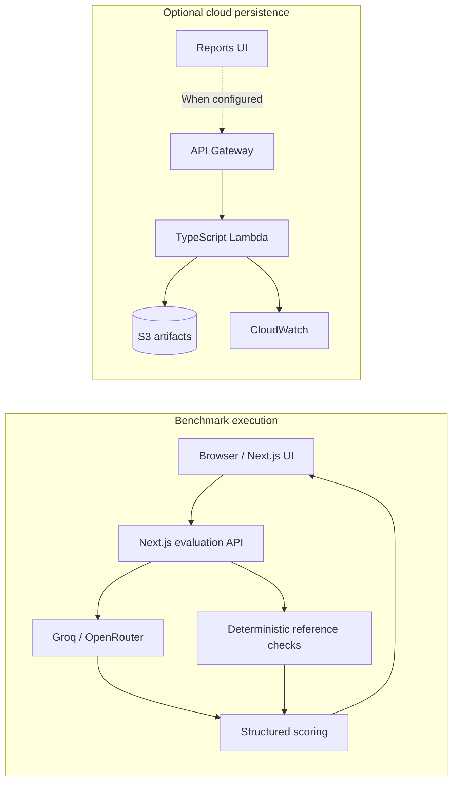

# LLM Workflow Benchmark Lab

**A full-stack platform for comparing LLM models, prompts, and multi-step workflows against deterministic reference logic and configurable scoring criteria.**

Build visual workflows, run batch benchmarks, inspect execution traces, and turn results into ranked reports.

[**Live Demo**](https://v0-clinical-case-input.vercel.app) · [Architecture](./docs/ARCHITECTURE.md) · [Evaluation Methodology](./docs/EVALUATION_METHODOLOGY.md) · [AWS Extension](./docs/AWS_ARCHITECTURE.md)


*Plan and execute a benchmark across model baselines, structured prompts, and reusable workflows.*

## Overview

LLM applications become difficult to evaluate when model choice, prompt structure, and workflow composition all affect the result. LLM Workflow Benchmark Lab makes those configurations testable, comparable, and traceable. It executes the same cases across selected configurations, evaluates outputs against deterministic reference checks, and exposes both aggregate scores and case-level evidence.

The included PCT-guided antibiotic stewardship workspace is a domain-specific example, not the scope of the platform itself. The underlying benchmark structure can be adapted to other evaluation domains with explicit reference logic.

## Core Capabilities

- Compare raw model calls, structured prompts, and multi-step workflows across Groq and OpenRouter models.
- Build reusable linear workflows visually, with configurable models, prompts, step types, and input sources.
- Evaluate outputs against deterministic reference logic separated from model generation.
- Configure weighted scoring for recommendation match, criterion alignment, safety, and explainability.
- Run batch benchmarks across selected cases and configurations with progress and failure reporting.
- Inspect case-level results and step-by-step workflow execution traces.
- Generate ranked reports and analyze merged run history, including replicate consistency.
- Import or export prompts, workflows, custom cases, criteria, settings, and benchmark history as a workspace.
- Explicitly save or load completed run artifacts through an optional AWS persistence extension when configured.

## Product Screenshots

### Visual Workflow Builder

Compose and validate reusable multi-step workflows, including chained LLM, verification, and final-report steps.


### Benchmark Results

Compare configuration-level aggregates, case-level scores, failures, and workflow traces.


### Ranked Reports

Review the evaluation rubric, executive metrics, ranked configurations, findings, and documented limitations.


<details>
<summary><strong>Additional product screens</strong></summary>

### Provider and Model Setup

Connect browser-session BYOK providers, load model catalogs, choose models, and configure evaluation criteria.


### Single-Case Execution

Run one structured case through a selected configuration while keeping reference checks and context visible.


</details>

## How the Benchmark Works

1. Select benchmark cases, provider models, prompt baselines, and enabled workflows.
2. Build a shared batch containing raw, structured-prompt, and workflow configurations.
3. Execute each configuration through the existing Next.js evaluation API and provider integrations.
4. Apply deterministic reference checks and structured scoring to the returned outputs.
5. Present configuration aggregates, case-level evidence, workflow traces, and ranked reports.
6. Preserve completed runs in browser-local history for later merging, reporting, and workspace export.

The scoring rubric measures recommendation match, criterion alignment, safety risk handling, and explainability. These scores measure alignment with the implemented benchmark rules—not real-world or clinical superiority.

## Implemented Architecture



Benchmark execution remains in the Next.js API routes. Lambda stores and retrieves completed benchmark artifacts only; it does not execute models or scoring logic.

## Engineering Highlights

- Next.js App Router and TypeScript across the frontend, evaluation APIs, cloud client, and Lambda.
- Groq and OpenRouter BYOK integrations, with browser-session keys separated from saved workspaces and artifacts.
- Structured benchmark, normalization, deterministic reference, and weighted-scoring pipeline.
- Reusable workflow execution with typed step configuration and inspectable traces.
- Browser-local, mergeable run history with duplicate and conflict handling plus full workspace import/export.
- Typed boundary validation and explicit error handling for provider, workspace, and cloud operations.
- AWS SAM infrastructure as code for API Gateway, Lambda, S3, CloudWatch, and IAM.
- UUID-addressed, conditional S3 writes with idempotent retries and overwrite conflict detection.
- Recursive secret rejection, structured/redacted logs, and least-privilege runtime IAM.

## Optional AWS Serverless Persistence

The Reports UI includes an explicit opt-in persistence path: **API Gateway → TypeScript Lambda → S3 + CloudWatch**. It is defined with AWS SAM and keeps browser-local history as the default. Conditional writes make identical retries idempotent while rejecting different content under the same UUID; validation enforces completed artifacts, a 4 MiB limit, and secret-pattern rejection. S3 remains private, encrypted, and versioned, while Lambda uses redacted structured logging and least-privilege IAM.

The extension was deployed and production-validated through the Vercel frontend. The temporary AWS demonstration infrastructure was then fully torn down, so **no AWS backend is currently live**. The reproducible implementation, tests, and deployment guidance remain in [the AWS architecture document](./docs/AWS_ARCHITECTURE.md).

## Example Workspace: PCT Case Study

The included workspace uses synthetic PCT-guided antibiotic stewardship cases to demonstrate structured inputs, threshold and decline calculations, exclusion flags, deterministic reference checks, configurable scoring, and multi-step workflow evaluation. A ready-to-import example is available at [`examples/pct-demo-workspace.json`](./examples/pct-demo-workspace.json).

> **Clinical and data disclaimer:** This is an LLM workflow benchmarking prototype, not clinical decision support. It is not clinically validated and must not be used for medical decisions. Use synthetic, non-sensitive data only—never PHI.

## Tech Stack

- **Application:** Next.js 16 App Router, React 19, TypeScript, Tailwind CSS, shadcn/ui-style primitives
- **Evaluation APIs:** Next.js route handlers, Groq, OpenRouter
- **Persistence:** browser `localStorage` / `sessionStorage`; optional AWS artifact persistence
- **AWS extension:** API Gateway HTTP API, Node.js 22 Lambda, S3, CloudWatch Logs, IAM, AWS SAM
- **Validation and testing:** Zod, Node test runner through `tsx`, TypeScript compiler, Next.js and SAM builds

## Local Setup

This repository uses `npm` and includes a committed `package-lock.json`.

```bash
npm install
copy .env.example .env.local
npm run dev
```

Open `http://localhost:3000`. Mock mode works without provider API keys; browser-session BYOK can be configured through the UI where supported.

Relevant optional environment variables:

```dotenv
USE_MOCK_LLM=true
OPENROUTER_API_KEY=
GROQ_API_KEY=
NEXT_PUBLIC_SITE_URL=http://localhost:3000
NEXT_PUBLIC_BENCHMARK_RUNS_API_URL=
```

Leave `NEXT_PUBLIC_BENCHMARK_RUNS_API_URL` empty unless the SAM extension has been deployed. When empty, cloud controls are hidden and the browser makes no AWS persistence requests. Never commit real provider or AWS credentials.

## Testing and Validation

```bash
npm test
npm run typecheck
npm run build
npm run sam:validate
npm run sam:build
```

- Benchmark logic, mock-mode API, and provider-catalog regression tests: **10/10 passing**.
- Cloud persistence and client tests: **11/11 passing**.
- TypeScript checking and the Next.js production build pass.
- The SAM template validates and the Node.js 22 Lambda bundles successfully.
- The temporary persistence deployment was smoke-tested end to end through the production Vercel frontend before teardown, including create, replay, retrieve, conflict, missing-run, validation, secret-rejection, and log-redaction behavior.

These checks demonstrate the captured implementation state; they do not imply continuous production monitoring.

## Current Limitations

- Browser-local storage remains the primary persistence layer; there is no application database or multi-user workspace model.
- The optional AWS demonstration API has no authentication and is not currently deployed.
- Provider rate limits and serverless timeouts can constrain larger or longer benchmark runs.
- Deterministic reference logic is a benchmark proxy rather than a universal ground truth.
- Mock/demo report fallback may appear when no batch run exists.

## Documentation

- [System architecture](./docs/ARCHITECTURE.md)
- [AWS persistence architecture and API contracts](./docs/AWS_ARCHITECTURE.md)
- [Evaluation methodology](./docs/EVALUATION_METHODOLOGY.md)
- [Workflow model](./docs/WORKFLOWS.md)
- [Security and BYOK boundaries](./docs/SECURITY_AND_BYOK.md)
- [Known limitations](./docs/LIMITATIONS.md)

## Future Direction

Potential future work—not currently implemented—includes authenticated database-backed workspaces, managed secret delegation, queued benchmark workers, audit trails, and real-time progress updates.
