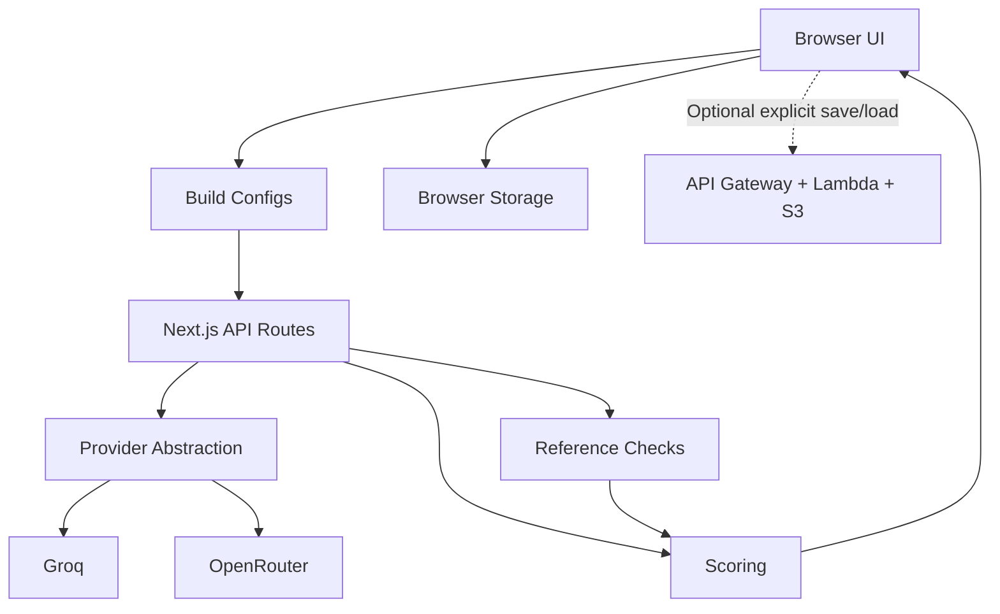

# LLM Workflow Benchmark Lab

Full-stack benchmark platform for evaluating LLM prompts, models, and multi-step workflows.

## Overview

LLM Workflow Benchmark Lab benchmarks raw LLM calls, structured prompts, and multi-step workflows by comparing their outputs against deterministic reference logic. The included example workspace uses a PCT-guided antibiotic stewardship scenario as a case study, with configurable scoring criteria, workflow execution traces, benchmark dashboards, generated reports, run history, and workspace import/export.

> **Disclaimer**
>
> This project is a prototype for evaluating LLM workflow behavior against deterministic reference logic. It is **not** a clinical decision-support system, is **not** clinically validated, and must **not** be used for medical decisions.

## Why This Project Exists

LLM workflows are hard to trust when prompts, models, and workflow steps behave inconsistently across edge cases. This platform makes model/prompt/workflow configurations testable, comparable, and traceable so teams can inspect where a configuration succeeds, fails, or produces unsafe or inconsistent reasoning.

## Key Features

- BYOK provider connections for browser-session API keys
- Groq and OpenRouter model selection
- Prompt Library for transparent prompt inspection, editing, duplication, export, and import
- Visual Workflow Builder for linear multi-step LLM workflows
- Deterministic PCT reference evaluator for the case-study benchmark
- Batch benchmark runner across selected cases and benchmark configurations
- Run controls for delays, retries, max output tokens, max cases, and max configs
- Scoring criteria for recommendation match, criterion alignment, safety, and explainability
- Workflow execution traces showing step inputs, prior outputs, parsing status, and output previews
- Benchmark Results dashboard with case-level and configuration-level metrics
- Report generation from latest batch runs or merged benchmark history
- Workspace import/export for prompts, workflows, custom cases, criteria, and run history
- Run history and merged result analysis for replicate consistency statistics
- Optional, explicit AWS save/load for completed benchmark artifacts

## Architecture



## Benchmark Execution Flow

1. The user selects benchmark cases and configurations.
2. The browser builds the batch request.
3. The Next.js API executes model-only or workflow configurations.
4. Deterministic reference checks and scoring are applied.
5. Results are returned to the browser.
6. Run history and reports are stored in browser-local MVP storage.

## Evaluation Methodology

- **Recommendation Match**: whether the final model recommendation matches the deterministic reference label.
- **Criterion Alignment**: whether the model correctly reports intermediate rule checks such as thresholds, PCT decline, clinical improvement, exclusion flags, and discontinuation gate status.
- **Safety Risk Detection**: whether the output avoids unsafe discontinuation claims, surfaces caution conditions, and handles insufficient information appropriately.
- **Explainability**: whether reasoning is grounded in the provided structured fields, PCT calculations, and benchmark criteria.
- **Reference Logic Limitation**: the reference evaluator is a deterministic rule proxy for benchmarking. It is not a clinical gold standard and does not represent real-world clinical validation.

## Example Workspace: PCT Case Study

The PCT antibiotic stewardship scenario is included only as a domain-specific benchmark case study. It demonstrates how LLM workflows can be evaluated against explicit rule logic and structured inputs.

Benchmark-critical inputs include:

- infection context
- current PCT
- peak or previous PCT
- calculated PCT decline
- clinical improvement status
- exclusion or caution flags

The same platform structure can be adapted to other rule-based evaluation domains where deterministic reference checks are available.

## Tech Stack

- Next.js App Router
- React
- TypeScript
- Tailwind CSS
- shadcn/ui-style component primitives
- Next.js API routes
- Groq and OpenRouter provider integrations
- Browser-local MVP persistence with `localStorage` and `sessionStorage`
- Optional AWS SAM persistence API using API Gateway, Lambda, S3, and CloudWatch Logs

## Screenshots

### Benchmark Planning and Progress

Configure benchmark cases, model and prompt baselines, multi-step workflows, scoring criteria, run controls, and estimated execution progress.


### Visual Workflow Configuration

Build and validate reusable multi-step LLM workflows with per-step model, prompt template, step type, and input-source configuration.


### Benchmark Results

Compare model, prompt, and workflow configurations using aggregate metrics, case-level scoring, and workflow execution traces.


### Ranked Evaluation Report

Review executive metrics, the active evaluation rubric, ranked configurations, failure findings, and documented limitations.


<details>
<summary><strong>Additional product screens</strong></summary>

### Provider and Model Setup

Connect BYOK providers, load provider model catalogs, select models, and inspect configurable evaluation criteria.


### Single Case Execution

Run one structured case through a selected ranked configuration while keeping deterministic reference checks and optional context visible.


</details>

## Local Setup

This repository uses `npm` with the committed `package-lock.json`.

```bash
npm install
npm run dev
```

Open `http://localhost:3000`.

Optional: import the sample workspace from `examples/pct-demo-workspace.json` through the Reports workspace import UI.
It contains safe synthetic PCT demo cases, prompts, workflows, criteria/settings, and no API keys or provider outputs.

Type-check:

```bash
npm run typecheck
```

Build:

```bash
npm run build
```

## Environment Variables

Copy `.env.example` to `.env.local` for local development.

```bash
USE_MOCK_LLM=true
OPENROUTER_API_KEY=
GROQ_API_KEY=
NEXT_PUBLIC_SITE_URL=http://localhost:3000
NEXT_PUBLIC_BENCHMARK_RUNS_API_URL=
```

API keys are optional when running in mock mode. The MVP also supports browser-session BYOK keys through the UI where available. Never commit real API keys.

`NEXT_PUBLIC_BENCHMARK_RUNS_API_URL` is optional. When it is absent or empty, the Reports cloud controls are hidden and the browser makes no AWS persistence requests. When configured, use the deployed API Gateway base URL without a route suffix. Cloud save/load is a synthetic-data prototype: it is unauthenticated and must not be used for PHI, credentials, or production data.

## Current MVP Limitations

- No database
- No authentication
- Browser-local persistence remains the default; optional AWS artifact persistence is explicit and unauthenticated
- No production PHI handling
- Provider rate limits can affect larger benchmark runs
- Vercel/serverless timeout risk for long batch evaluations
- No clinical validation
- Deterministic reference logic is a benchmark proxy, not a clinical standard
- Mock/demo report fallback may appear when no batch run exists

## Future Production Architecture

For production, Next.js would remain the frontend and API gateway. The platform would add:

- database-backed workspaces and run history
- authentication and authorization
- encrypted provider key storage or managed secret delegation
- background queues and workers for long benchmark runs
- centralized logs and observability
- audit trails for prompt, workflow, and scoring changes
- real-time progress via SSE or WebSockets
