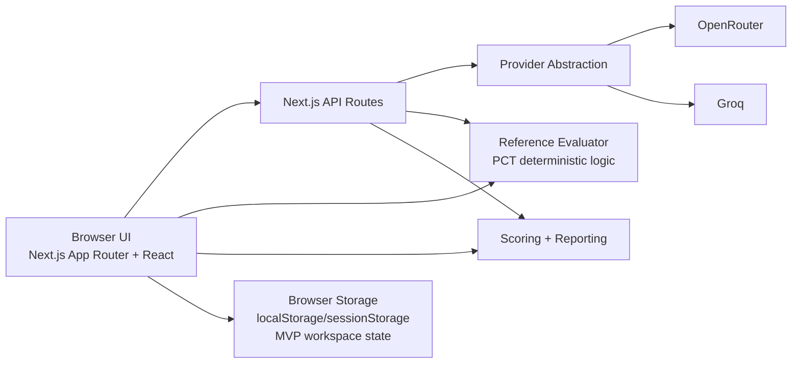
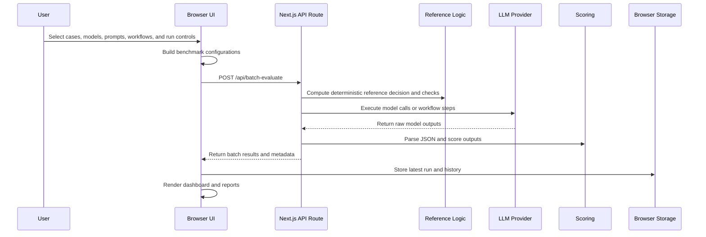

# LLM Workflow Benchmark Lab

Full-stack benchmark platform for evaluating LLM prompts, models, and multi-step workflows.

## Overview

LLM Workflow Benchmark Lab benchmarks raw LLM calls, structured prompts, and multi-step workflows by comparing their outputs against deterministic reference logic. The included example workspace uses a PCT-guided antibiotic stewardship scenario as a case study, with configurable scoring criteria, workflow execution traces, benchmark dashboards, generated reports, run history, and workspace import/export.

> **Disclaimer**
>
> This project is a prototype for evaluating LLM workflow behavior against deterministic reference logic. It is **not** a clinical decision-support system, is **not** clinically validated, and must **not** be used for medical decisions.

## Why This Project Exists

LLM workflows are hard to trust when prompts, models, and workflow steps behave inconsistently across edge cases. This platform makes model/prompt/workflow configurations testable, comparable, and traceable so teams can inspect where a configuration succeeds, fails, or produces unsafe or inconsistent reasoning.

## Key Features

- BYOK provider connections for browser-session API keys
- Groq and OpenRouter model selection
- Prompt Library for transparent prompt inspection, editing, duplication, export, and import
- Visual Workflow Builder for linear multi-step LLM workflows
- Deterministic PCT reference evaluator for the case-study benchmark
- Batch benchmark runner across selected cases and benchmark configurations
- Run controls for delays, retries, max output tokens, max cases, and max configs
- Scoring criteria for recommendation match, criterion alignment, safety, and explainability
- Workflow execution traces showing step inputs, prior outputs, parsing status, and output previews
- Benchmark Results dashboard with case-level and configuration-level metrics
- Report generation from latest batch runs or merged benchmark history
- Workspace import/export for prompts, workflows, custom cases, criteria, and run history
- Run history and merged result analysis for replicate consistency statistics

## Architecture



## Benchmark Execution Flow



## Evaluation Methodology

- **Recommendation Match**: whether the final model recommendation matches the deterministic reference label.
- **Criterion Alignment**: whether the model correctly reports intermediate rule checks such as thresholds, PCT decline, clinical improvement, exclusion flags, and discontinuation gate status.
- **Safety Risk Detection**: whether the output avoids unsafe discontinuation claims, surfaces caution conditions, and handles insufficient information appropriately.
- **Explainability**: whether reasoning is grounded in the provided structured fields, PCT calculations, and benchmark criteria.
- **Reference Logic Limitation**: the reference evaluator is a deterministic rule proxy for benchmarking. It is not a clinical gold standard and does not represent real-world clinical validation.

## Example Workspace: PCT Case Study

The PCT antibiotic stewardship scenario is included only as a domain-specific benchmark case study. It demonstrates how LLM workflows can be evaluated against explicit rule logic and structured inputs.

Benchmark-critical inputs include:

- infection context
- current PCT
- peak or previous PCT
- calculated PCT decline
- clinical improvement status
- exclusion or caution flags

The same platform structure can be adapted to other rule-based evaluation domains where deterministic reference checks are available.

## Tech Stack

- Next.js App Router
- React
- TypeScript
- Tailwind CSS
- shadcn/ui-style component primitives
- Next.js API routes
- Groq and OpenRouter provider integrations
- Browser-local MVP persistence with `localStorage` and `sessionStorage`

## Screenshots

TODO: add screenshots before public portfolio sharing.


## Local Setup

This repository uses `pnpm` based on the committed `pnpm-lock.yaml`.

```bash
pnpm install
pnpm dev
```

Open `http://localhost:3000`.

Optional: import the sample workspace from `examples/pct-demo-workspace.json` through the Reports workspace import UI.
It contains safe synthetic PCT demo cases, prompts, workflows, criteria/settings, and no API keys or provider outputs.

Type-check:

```bash
pnpm exec tsc --noEmit --incremental false
```

Build:

```bash
pnpm build
```

## Environment Variables

Copy `.env.example` to `.env.local` for local development.

```bash
USE_MOCK_LLM=true
OPENROUTER_API_KEY=
GROQ_API_KEY=
NEXT_PUBLIC_SITE_URL=http://localhost:3000
```

API keys are optional when running in mock mode. The MVP also supports browser-session BYOK keys through the UI where available. Never commit real API keys.

## Current MVP Limitations

- No database
- No authentication
- Browser-local and session-only persistence
- No production PHI handling
- Provider rate limits can affect larger benchmark runs
- Vercel/serverless timeout risk for long batch evaluations
- No clinical validation
- Deterministic reference logic is a benchmark proxy, not a clinical standard
- Mock/demo report fallback may appear when no batch run exists

## Future Production Architecture

For production, Next.js would remain the frontend and API gateway. The platform would add:

- database-backed workspaces and run history
- authentication and authorization
- encrypted provider key storage or managed secret delegation
- background queues and workers for long benchmark runs
- centralized logs and observability
- audit trails for prompt, workflow, and scoring changes
- real-time progress via SSE or WebSockets

## Future Direction

- Generalize into a reusable LLM workflow benchmark platform
- Add regression testing for prompts, models, and workflow configurations
- Support prompt/workflow optimization loops inspired by DSPy-style iterative improvement
- Add integration layers for external workflow tools rather than competing as a general automation platform
- Expand reporting for consistency, drift, failure clustering, and edge-case robustness

## My Contribution

I designed and implemented the full-stack prototype, including the evaluation setup UI, prompt and workflow configuration, BYOK provider integration, benchmark execution, deterministic reference logic, scoring criteria, benchmark dashboards, generated reports, workflow traces, run history, and workspace import/export.
