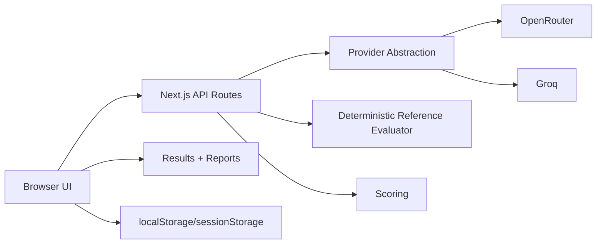

# Architecture

LLM Workflow Benchmark Lab is a Next.js App Router prototype for comparing model, prompt, and workflow configurations against deterministic reference logic.

## High-Level Architecture

## Frontend Pages

- `/`: single-case execution page. Users enter a manual case, choose one ranked execution configuration, and run one case.
- `/evaluation-setup`: benchmark lab for provider connections, model selection, prompt templates, workflow builder, criteria, benchmark cases, run controls, and summary.
- `/benchmark-results`: displays latest batch benchmark results and latest single-case execution results.
- `/reports`: generates reports from the latest batch result or merged benchmark run history.

## API Routes

- `POST /api/evaluate`: single-case evaluation.
- `POST /api/batch-evaluate`: sequential batch benchmark execution across cases and configurations.
- `POST /api/models`: provider model catalog refresh using a BYOK API key.
- `POST /api/models/test`: small model availability test.
- `POST /api/providers/test`: provider connection test.

## Provider Integration

Provider logic is centralized in `lib/llm-providers.ts`.

Supported MVP providers:

- OpenRouter
- Groq

Provider calls use `fetch` with bearer authentication. The MVP accepts provider keys from the browser session and sends them to API routes for the current request. Keys are not stored server-side by this app.

## Benchmark Execution Flow

1. User selects provider, models, prompt templates, workflows, cases, and run controls.
2. Frontend builds benchmark configurations.
3. `POST /api/batch-evaluate` receives the selected configs and cases.
4. For each case, the API computes deterministic reference decision/checks.
5. For each benchmark config, the API calls the provider or executes workflow steps.
6. Outputs are parsed and scored.
7. Results return to the browser and are stored in browser storage.
8. Results and Reports pages aggregate and display metrics.

## Workflow Execution Flow

Workflows are linear sequences of steps. A workflow can include LLM calls, verification steps, deterministic precheck steps, and final report steps.

The final step output is used for scoring when parseable. Workflow results include trace metadata so users can inspect which previous outputs were included in each step.

## Prompt and Template Data Flow

- Prompt templates are stored in browser `localStorage` under `promptTemplates`.
- Workflow steps reference prompts by `promptTemplateId`.
- Model-only benchmark configs use selected prompt templates.
- Batch requests include the prompt templates needed by selected configurations.
- Prompts can be exported/imported separately from the full workspace.

## Scoring and Reporting Flow

- Reference checks are computed from structured case fields.
- LLM output is parsed as JSON where possible.
- Scoring compares parsed output to deterministic reference checks.
- Reports aggregate configuration-level scores and run-history consistency statistics.

## Browser Storage Usage in MVP

The MVP uses browser storage instead of a database:

- `sessionStorage`: latest single-case and batch run outputs, provider model catalog, session BYOK keys.
- `localStorage`: prompt templates, workflows, custom cases, criteria, settings, benchmark run history.

This is suitable for a prototype, not production PHI or multi-user data handling.

## Production Architecture Extension

A production version would add:

- authenticated users and organizations
- database-backed workspaces
- encrypted provider key storage or delegated secrets
- background workers/queues for long-running benchmarks
- streaming progress via SSE or WebSockets
- centralized logs and observability
- audit trails for prompts, workflows, criteria, and benchmark runs
- data privacy and regulatory review before any sensitive-domain usage
