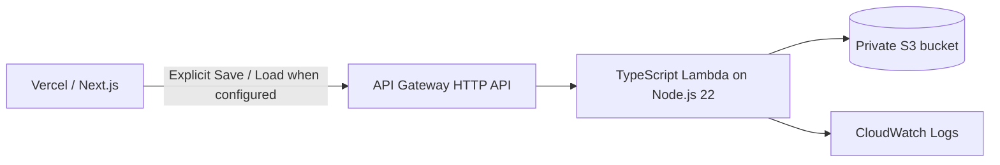

# AWS Benchmark Artifact Persistence

Phase 1 implemented an optional AWS persistence API for completed benchmark-run artifacts. Phase 2 added explicit save/load controls to the Reports workspace-sharing section. Neither phase changed benchmark execution, scoring, deterministic reference logic, provider integrations, or the existing browser run-history behavior.

The integration is disabled unless `NEXT_PUBLIC_BENCHMARK_RUNS_API_URL` is configured at frontend build time. With the variable absent, cloud controls are hidden and the browser makes no AWS persistence requests, preserving existing application behavior and Vercel compatibility.

## Current deployment status

The extension was deployed to a temporary development stack and production-validated through the Vercel frontend. After evidence was captured, the application stack, SAM bootstrap stack, Lambda, API Gateway resources, log group, execution role, versioned artifact buckets, and SAM staging bucket were fully removed. No project AWS backend is currently live. The Vercel production environment no longer configures the API URL, while the tested SAM infrastructure remains reproducible from this repository.

## Architecture



AWS Amplify Hosting, authentication, DynamoDB, queues, workflow orchestration, and Lambda-based benchmark execution are intentionally out of scope.

During validation, the temporary development stack ran in `eu-central-1` with the production Vercel origin explicitly allowed by CORS. The endpoint was supplied through environment configuration rather than hardcoded in the client, and that configuration was removed after teardown.

## Optional Reports integration

When reproducing the extension, set the public API Gateway base URL only when the prototype cloud feature should be available:

```bash
NEXT_PUBLIC_BENCHMARK_RUNS_API_URL=https://example.execute-api.eu-central-1.amazonaws.com
```

The Reports page provides only explicit actions:

- **Save Run to AWS** sends one user-selected, completed `BenchmarkRunHistoryEntry` under a newly generated browser UUID.
- **Load Cloud Run** retrieves one UUID and passes the artifact through the existing workspace run-history duplicate, conflict, and merge logic.

Local browser history remains primary. An exact duplicate is skipped, a conflicting batch ID requires the existing import conflict choice and explicit apply action, and request failures do not change local state. The client sends no authentication header and performs a secret-pattern preflight, while the Lambda remains the authoritative validator.

This is an unauthenticated prototype for synthetic, non-sensitive data only. Do not upload PHI, provider keys, credentials, or production data. The API Gateway CORS origins must explicitly include each frontend origin that needs browser access; a locally served frontend cannot call a deployment configured only for a hosted production origin.

## Artifact contract

The service reuses `BenchmarkRunHistoryEntry` from `lib/workspace-sharing.ts`. It does not define a second benchmark result schema.

`POST /benchmark-runs` request:

```json
{
  "runId": "3bc956b2-0386-4daf-b980-7c4669fd19d9",
  "artifact": {
    "schemaVersion": "1.0",
    "scoringVersion": "1.0",
    "appName": "LLM Workflow Benchmark Lab",
    "batchId": "batch-1786622400000",
    "createdAt": "2026-08-13T12:00:00.000Z",
    "providerId": "openrouter",
    "aggregate": {},
    "cases": [],
    "rawBatch": {}
  }
}
```

The abbreviated artifact above illustrates the envelope only. A real request must contain a completed `BenchmarkRunHistoryEntry`, including at least one case and result, consistent `cases` and `aggregate` snapshots in `rawBatch`, and the matching batch ID, timestamp, and provider.

The Lambda validates the UUID, schema/application versions, required structure, completed-run consistency, a fixed 4 MiB serialized artifact limit, and recursively rejects likely secret fields and credential patterns. Provider API keys and authorization tokens must never be sent.

Successful first write (`201`):

```json
{
  "runId": "3bc956b2-0386-4daf-b980-7c4669fd19d9",
  "created": true,
  "contentSha256": "<sha256>",
  "artifactByteSize": 12345
}
```

An identical retry returns `200` with `created: false`. The Lambda canonicalizes JSON before hashing and storage, so property order does not affect identity. A UUID already associated with different content returns `409 RUN_ID_CONFLICT`.

`GET /benchmark-runs/{runId}` returns `200`:

```json
{
  "runId": "3bc956b2-0386-4daf-b980-7c4669fd19d9",
  "artifact": {},
  "contentSha256": "<sha256>",
  "artifactByteSize": 12345,
  "storedAt": "2026-08-13T12:00:02.000Z"
}
```

Errors use this shape:

```json
{
  "error": {
    "code": "INVALID_ARTIFACT",
    "message": "The artifact does not match the BenchmarkRunHistoryEntry structure.",
    "requestId": "<api-gateway-request-id>",
    "retryable": false
  }
}
```

Expected status codes are `400`, `404`, `409`, `413`, `415`, `500`, and `503`. Only temporary storage errors are marked retryable.

## Validated behavior

The deployed demonstration passed end-to-end checks for:

- first conditional create: `201`
- identical idempotent replay: `200`
- artifact retrieval: `200`
- same UUID with different content: `409`
- missing UUID: `404`
- invalid, incomplete, or secret-containing artifacts: `400`

Production frontend validation also confirmed explicit save/load, successful first import, existing duplicate detection on a second load, clean missing-run handling, and failure isolation from local browser history.

## S3 and idempotency

Artifacts are stored directly, without another storage envelope, at:

```text
benchmark-runs/v1/{runId}.json
```

SAM configures the artifact bucket with all S3 Block Public Access controls enabled, bucket-owner-enforced ownership, explicit SSE-S3 default encryption, and versioning. CloudFormation generates the bucket name. The template retains the bucket when the stack is deleted to avoid accidental artifact loss, so teardown must explicitly remove all versions and delete markers before deleting the bucket.

Every write includes `If-None-Match: *`. S3 therefore creates a new key only when no current object exists. After a conditional-write failure, the Lambda uses its read permission to compare the stored canonical artifact:

- same content: idempotent `200`
- different content: conflict `409`
- transient or inconsistent storage state: retryable `503`

The Lambda never issues an unconditional overwrite and has no delete permission.
The bucket policy also denies `PutObject` requests to the artifact prefix when the conditional-write header is absent, so this invariant does not depend only on handler code.

## IAM

The function role permits only:

- `s3:GetObject` on the generated bucket's `benchmark-runs/v1/*` objects
- `s3:PutObject` on the same prefix
- `s3:ListBucket` on the dedicated generated artifact bucket so a missing `GetObject` can return `404`
- `logs:CreateLogStream` and `logs:PutLogEvents` on the function's exact CloudWatch log group

It does not receive `s3:DeleteObject`, `s3:ListBucketVersions`, a broad S3 allow, provider access, or database permissions. A bucket policy denies insecure HTTP reads and writes on the artifact prefix.

## Logging

The Lambda writes one structured JSON record per request. Permitted fields are:

- `requestId`
- `route`
- `runId`
- `artifactByteSize`
- `operationResult`
- `latencyMs`
- `safeAwsErrorClass`

Undefined fields are omitted. Request bodies, headers, prompts, raw model output, artifacts, API keys, authorization values, error messages, stack traces, and full exception objects are never logged. The SAM template creates the log group with configurable retention, defaulting to 14 days.

## CORS and public access risk

`AllowedOrigins` is a required deployment decision represented by a SAM `CommaDelimitedList` parameter. Its development default is only `http://localhost:3000`; the template never defaults to `*`.

CORS is a browser control, not authentication. Until authentication and authorization are added, any non-browser client that knows the HTTP API URL can attempt to create or retrieve artifacts. Use a non-production AWS account, explicit throttling, synthetic data, AWS Budgets, and CloudWatch monitoring for this demonstration phase. Do not store PHI or real patient records.

## Local checks

Install project dependencies, then run:

```bash
npm run test:cloud
npm run typecheck
npm run build
npm run sam:validate
npm run sam:build
```

The last two commands require the AWS SAM CLI. `sam build` uses the repository's esbuild development dependency. The sample API Gateway v2 events are in `infra/events/post.json` and `infra/events/get.json`; invocation against S3 additionally requires a configured bucket and AWS credentials, so the unit tests use an in-memory S3 test double instead.

## Reproducible deployment and teardown boundary

The development demonstration was deployed, production-validated, and torn down. Deployment remains a manual, reviewable operation. To reproduce it in a non-production account:

1. Install AWS CLI v2 and AWS SAM CLI.
2. Configure an AWS profile or role for the intended non-production account and Region.
3. Confirm the CloudFormation deployment identity can create IAM roles, Lambda, API Gateway v2, S3, and CloudWatch Logs resources.
4. Choose exact application origins, including scheme and hostname. Do not use a wildcard.
5. Run the local checks above.
6. Run `sam deploy --guided --template-file .aws-sam/build/template.yaml` and enter the explicit `AllowedOrigins` value.
7. Record the `BenchmarkRunsApiUrl` stack output outside source control.
8. Smoke-test create, identical replay, conflict, retrieval, secret rejection, and size rejection using synthetic data.
9. Inspect the Lambda role and CloudWatch logs before enabling the optional frontend integration.

The validation deployment and all retained/bootstrap resources were removed after frontend evidence was captured. No project AWS resources are intentionally left running. A future reproduction remains temporary portfolio infrastructure, not a production SaaS backend. Because the S3 bucket uses `DeletionPolicy: Retain`, deleting the application stack alone does not delete the bucket or its artifacts; teardown must include a separate, deliberate version-aware cleanup process.
